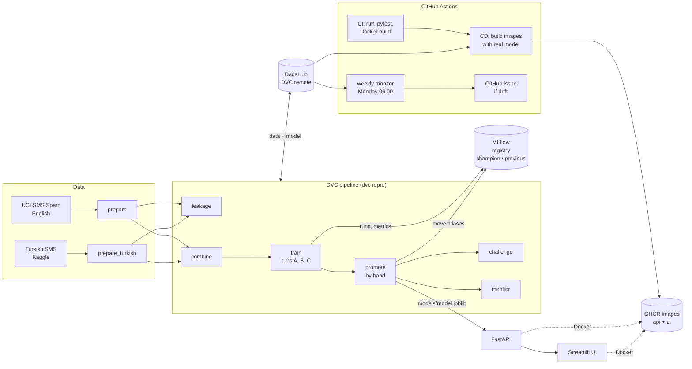

# SMS Fraud Detection

[](https://github.com/yusufBahadirAvci/sms-fraud-detection/actions/workflows/ci.yml)
[](https://github.com/yusufBahadirAvci/sms-fraud-detection/actions/workflows/cd.yml)

This project finds fraud (spam and phishing) in SMS messages.
It works for **English** and **Turkish** messages.
It is a full MLOps project: data versioning, a reproducible pipeline,
experiment tracking, a model registry, an API, a UI, Docker, CI/CD and monitoring.

The model is TF-IDF on letter pieces (char n-grams) + Logistic Regression.
A simple rule-based model (keyword list) is the baseline.

A study guide for every concept in this project is in [docs/CONCEPTS.md](docs/CONCEPTS.md).
The design patterns are listed in [PATTERNS.md](PATTERNS.md).

## Architecture



## Quick start

### 1. Local (Python 3.12)

```powershell
python -m venv .venv
.\.venv\Scripts\activate
pip install -r requirements-dev.txt

# Get data and model from DagsHub (your token goes to .dvc/config.local, not Git)
dvc remote modify origin --local access_key_id <DagsHub token>
dvc remote modify origin --local secret_access_key <DagsHub token>
dvc pull

dvc repro                                   # run the pipeline (only changed stages run)
uvicorn src.sms_fraud.api:app --port 8000   # terminal 1: API, docs at http://localhost:8000/docs
streamlit run ui/app.py                     # terminal 2: UI at http://localhost:8501
```

### 2. Docker (build on your computer)

`models/model.joblib` must exist (`dvc pull`). It is copied into the API image.

```powershell
docker compose up --build -d    # start api + ui
docker compose ps               # api must be "healthy"
docker compose down             # stop
```

### 3. Pull the images from GHCR

CD pushes two tags: the short commit sha (never moves) and `latest`.

```powershell
docker network create sms
docker run -d --name api --network sms -p 8000:8000 ghcr.io/yusufbahadiravci/sms-fraud-api:latest
docker run -d --name ui --network sms -p 8501:8501 -e API_URL=http://api:8000 ghcr.io/yusufbahadiravci/sms-fraud-ui:latest
```

If the packages are private, run `docker login ghcr.io` first.

### Example request

```powershell
curl.exe -X POST http://localhost:8000/predict -H "Content-Type: application/json" -d '{\"message\": \"You won a FREE prize! Call now\"}'
```

## Results (v1.0.0)

The champion is **B_char** (MLflow version 19, alias `champion`).
It was trained on the **clean split**: near-duplicate messages are never in both
train and test. So every test message is new for this model.

| Model | Test set | Precision | Recall | F1 |
|---|---|---|---|---|
| **B_char (champion v19)** | English, clean (1032 rows) | 0.983 | 0.883 | **0.930** |
| **B_char (champion v19)** | Turkish, clean (948 rows) | 1.000 | 0.996 | **0.998** |
| **B_char (champion v19)** | Turkish phishing challenge set (40 rows) | 1.000 | 0.850 | **0.919** |
| Rule-based baseline | English, clean | 1.000 | 0.094 | 0.171 |
| Rule-based baseline | Turkish, clean | 0.941 | 0.063 | 0.119 |
| Rule-based baseline | Turkish phishing challenge set | 1.000 | 0.350 | 0.519 |

Old champion (v13, trained on the old random split), scored only on test rows it never saw
(no near-copy in its training data): English F1 0.884 (198 rows), Turkish F1 0.994 (157 rows).
On these same rows, B_char gets the same scores. Details: [reports/promotion.md](reports/promotion.md).

Other reports:
[metrics.json](reports/metrics.json) (runs A, B, C) ·
[metrics_old_split.json](reports/metrics_old_split.json) (same runs on the old, leaky split) ·
[leakage.md](reports/leakage.md) ·
[challenge.md](reports/challenge.md) ·
[monitoring/drift_report.md](reports/monitoring/drift_report.md)

## How the model gets to production

```powershell
dvc repro train                                      # train runs A, B, C -> models/candidates/
python -m src.sms_fraud.promote                      # champion vs best new run (by Turkish F1)
dvc add models/model.joblib                          # only if promoted
dvc repro                                            # re-run challenge + monitor with the new model
dvc push                                             # upload data and model to DagsHub
git commit -am "..." && git push                     # CI -> CD -> new images on GHCR
python -m src.sms_fraud.promote rollback             # go back to the "previous" model
```

Promotion rule (`config/config.yaml`, `promotion:`):
the challenger's Turkish F1 must be **higher**, and its English F1 may be **at most 0.02 lower**.

## Monitoring

- `dvc repro monitor`: per language, half of the test set (reference) vs the other half (current).
- Checks: OOV ratio, message length (KS test), spam probability (PSI), F1 drop.
- The API logs every prediction to `logs/predictions.jsonl` with the detected language.
  `python -m src.sms_fraud.monitoring --mode log` checks this live traffic.
- Every Monday, GitHub Actions runs monitoring. If a threshold is crossed, it opens a GitHub issue.

## Tests and lint

```powershell
ruff check .
ruff format --check .
pytest --cov=src        # tiny fake data; no real data or model needed
```

## Known limitations

- **Turkish data is mostly advertising spam.** The Turkish dataset has shop and bank adverts
  vs. personal messages. This is easy to separate, so Turkish F1 (0.998) is too optimistic
  for real fraud.
- **Phishing recall is low.** On the hand-written challenge set, the model missed 3 of 20
  phishing messages (recall 0.85):
  - "Hesabınıza yeni bir cihazdan giriş yapıldı. Siz değilseniz şifrenizi buradan sıfırlayın: https://guvenli-giris.example.com" (spam prob 0.41)
  - "Operatörünüz: Yeni SIM kartınız için bilgilerinizi doğrulayın, aksi halde hattınız askıya alınacak. example.com/sim" (0.41)
  - "Merhaba anne, telefonum bozuldu bu yeni numaram. Acil 2000 TL lazım bu IBAN'a atar mısın ..." (0.27)
  These look like normal service messages. The training data has almost no phishing like this.
- **English recall is lower than precision** (0.88 vs 0.98): about 1 in 9 English spam messages is missed.
- **Per-language reference windows.** Monitoring needs a language detector
  (`text_stats.detect_language`, simple rules, about 97% correct). Wrong detection can mix the windows.
  A new language would need its own reference window.
- **Small datasets.** About 5,100 English and 4,700 Turkish messages. The challenge set has only 40.
  One message changes challenge recall by 0.05.
- **MLflow is a local SQLite file** (`mlruns/mlflow.db`, not in Git or DVC). The registry and the
  aliases exist only on one computer. CI/CD uses the DVC model file, not the registry.
- **Line endings.** Report files written on Windows have CRLF. DVC hashes them as they are, so
  `dvc status` on Linux may show these small reports as changed.

## What I would do next

1. Collect real, labelled Turkish phishing SMS (with consent) and add them to training.
2. Tune the decision threshold for higher recall (now 0.5), and check the precision cost.
3. Move MLflow to a shared server (for example DagsHub MLflow), so the registry is not on one laptop.
4. Use a better language detector (for example fastText `lid.176`) and log its confidence.
5. Retrain automatically when monitoring finds real drift, and promote with the same rule.
